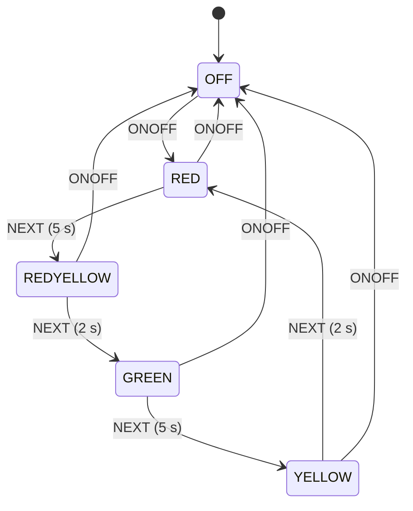

# ESP32 FSM Traffic Light

A traffic light implemented as a **finite state machine (FSM)**. A button switches it on and off; while off, all lights blink.

> **Learning path:** 3. FSM · [← Previous: Project Traffic Light](../esp32-project-traffic-light) · [Next: FSM Vending Machine →](../esp32-fsm-vending-machine)

## New Concepts

- **Finite state machine**: states, events and transitions
- `enum` for **states** (`OFF`, `RED`, `REDYELLOW`, `GREEN`, `YELLOW`) and **events** (`ONOFF`, `NEXT`)
- `handleEvent(event)` – decides the next state based on the current state and the event
- `enterState(state)` – entry actions: set the LEDs and schedule the next transition
- Function **forward declarations**
- Formatted output with `Serial.printf()`

## State Diagram

## Wiring

| Part          | ESP32 pin | Notes                               |
| ------------- | --------- | ----------------------------------- |
| Red LED       | GPIO 19   | 220 Ω resistor to GND               |
| Yellow LED    | GPIO 18   | 220 Ω resistor to GND               |
| Green LED     | GPIO 5    | 220 Ω resistor to GND               |
| ON/OFF button | GPIO 34   | other side to GND, 10 kΩ pull-up to 3V3 |

Serial monitor: 115200 baud.

## How it works

The `loop()` only **generates events**: a button press creates `ONOFF`, an expired timer creates `NEXT`. All decisions happen in `handleEvent()`, all outputs in `enterState()`. Adding a new state means adding one `case` in each function – no scattered flags.

## Exercises

1. Add a `NIGHT` state (blinking yellow) reachable with a second button.
2. Replace `millis() >= nextTransitionTime` with the overflow-safe `millis() - stateStartTime >= duration` pattern.
3. Replace the blocking debounce `delay(60)` with the `millis()` version from section 2.

## Further Reading

- [Wikipedia: Finite-state machine](https://en.wikipedia.org/wiki/Finite-state_machine)
- [Mermaid state diagrams](https://mermaid.js.org/syntax/stateDiagram.html)
