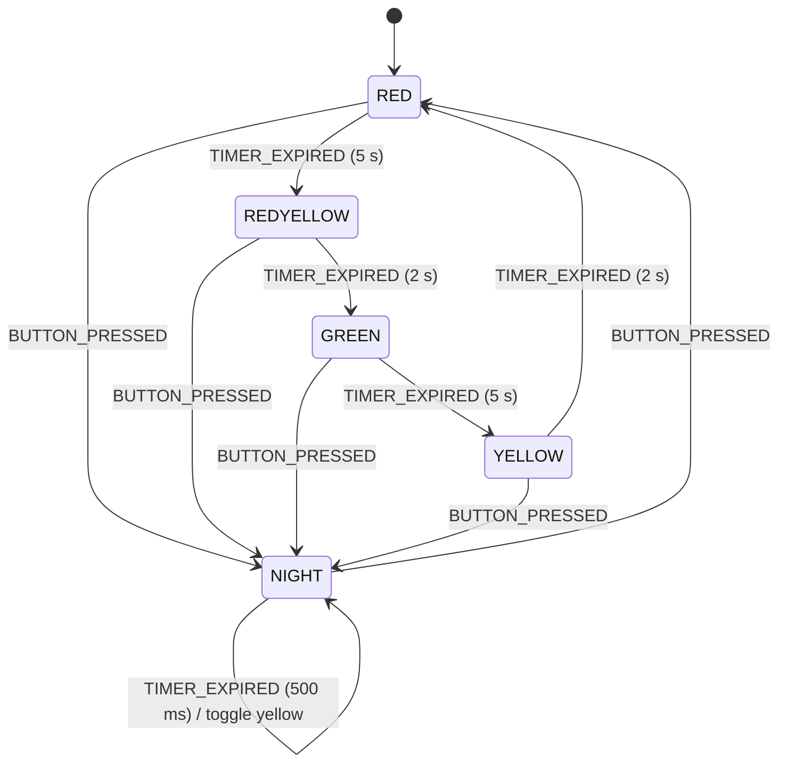

# ESP32 FSM Traffic Light

The traffic light from the [project](../esp32-project-traffic-light), rebuilt as a **finite state machine (FSM)**: red → red+yellow → green → yellow, and a button that switches to a blinking-yellow **night mode**.

> **Learning path:** 3. FSM · [← Previous: Project Traffic Light](../esp32-project-traffic-light) · [Next: FSM Vending Machine →](../esp32-fsm-vending-machine)

## New Concepts

- **Finite state machine**: states, events and transitions
- `enum` for **states** (`RED`, `REDYELLOW`, `GREEN`, `YELLOW`, `NIGHT`) and **events** (`BUTTON_PRESSED`, `TIMER_EXPIRED`): names instead of magic numbers
- `switch` / `case` to select the code for the current state
- `handleEvent(event)`: the **transitions**, which pick the next state based on the current state and the event
- `enterState(state)`: the **entry actions**, which set the LEDs and start the state timer
- **Internal transitions**: an event that is handled without leaving the state (blinking in `NIGHT`)
- Function **forward declarations**

## State Diagram

## Wiring

Same circuit as [Project Traffic Light](../esp32-project-traffic-light).

| Part          | ESP32 pin | Notes                                   |
| ------------- | --------- | --------------------------------------- |
| Red LED       | GPIO 19   | 220 Ω resistor to GND                   |
| Yellow LED    | GPIO 18   | 220 Ω resistor to GND                   |
| Green LED     | GPIO 5    | 220 Ω resistor to GND                   |
| Night button  | GPIO 34   | other side to GND, 10 kΩ pull-up to 3V3 |

Serial monitor: 115200 baud.

## How it works

The program has three parts with clearly separated jobs:

| Part            | Job                                                                 |
| --------------- | ------------------------------------------------------------------- |
| `loop()`        | only **generates events**: a button press creates `BUTTON_PRESSED`, an expired timer creates `TIMER_EXPIRED` |
| `handleEvent()` | decides **where to go**: one `case` per state, one `if` per event  |
| `enterState()`  | decides **what happens** on arrival: lights on/off, start the timer |

Every state starts the same timer with its own duration (`startTimer(greenDuration)`). There is no special timing code per state. In `NIGHT` the timer's job is the blinking: `TIMER_EXPIRED` toggles the yellow LED and restarts the timer, but the state stays the same.

> **Compare with the project:** in [Project Traffic Light](../esp32-project-traffic-light) the phase was a number (`phase == 1`) and night mode a separate flag that had to reset the phase, the timer and the lights. Here every situation is a named state, and night mode is just one more state. The red+yellow phase, which was an exercise there, only needs one more `case` in each function here.

## FSM Rules of Thumb

These rules keep a state machine easy to read and extend:

1. **Events say what happened** (`BUTTON_PRESSED`), not what to do (`GO_TO_NIGHT`). The current state decides what an event means: the same button press starts night mode in `RED` and ends it in `NIGHT`.
2. **`loop()` only generates events.** It never checks `state` itself.
3. **Change the state only through `enterState()`.** Then the entry actions can't be forgotten. That includes the initial state: `setup()` calls `enterState(RED)` instead of just setting `state = RED`.
4. **Never block.** No `delay()` anywhere, so the button works in every state at any time.
5. **Ignoring an event is fine.** If a state has no `if` for an event, nothing happens.

## Exercises

1. Add a pedestrian button on GPIO 35 and a new event `PEDESTRIAN_PRESSED`. It only does something in `GREEN`, where it ends the green phase early. All other states ignore it.
2. Replace the internal transition with two states `NIGHT_ON` and `NIGHT_OFF` that switch back and forth on `TIMER_EXPIRED`. Now you don't need the `yellowState` variable anymore. Which version do you find clearer?
3. Add an `ALL_RED` state (2 s) between `YELLOW` and `RED`, the safety phase of real crossings. How many places in the code did you have to change? Compare with the project.

## Further Reading

- [Wikipedia: Finite-state machine](https://en.wikipedia.org/wiki/Finite-state_machine)
- [Mermaid state diagrams](https://mermaid.js.org/syntax/stateDiagram.html)
