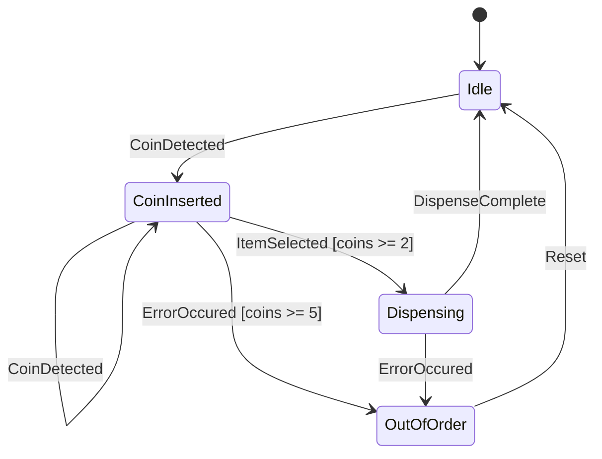

# ESP32 FSM Vending Machine

A simplified vending machine as a second, more complex FSM example: insert coins, select an item, get it dispensed – or end up "out of order".

> **Learning path:** 3. FSM · [← Previous: FSM Traffic Light](../esp32-fsm-traffic-light) · [Next: External Interrupt Button →](../esp32-exti-btn)

## New Concepts

- `enum class` – scoped, type-safe enums (`VendingState::Idle`)
- `static_cast<int>()` to print an `enum class` value
- **Guards**: a transition only happens if a condition is true (`currentCoinCounter >= requiredCoins`)
- Reusable helper function with **pass by reference** (`bool &lastButtonState`)
- `static` local variables inside `loop()`
- State-dependent behaviour in `loop()` (blinking LED in `CoinInserted`)

## State Diagram

## Wiring

| Part                  | ESP32 pin | Wokwi key | Notes                       |
| --------------------- | --------- | --------- | --------------------------- |
| "Insert Coin" button  | GPIO 34   | `Space`   | 10 kΩ pull-up, active low   |
| "Select Item" button  | GPIO 35   | `s`       | 10 kΩ pull-up, active low   |
| "Reset" button        | GPIO 27   | `r`       | 10 kΩ pull-up, active low   |
| Error LED (red)       | GPIO 19   |           | 220 Ω resistor to GND       |
| Ready LED (green)     | GPIO 18   |           | 220 Ω resistor to GND       |

Serial monitor: 115200 baud. In Wokwi, click on the simulation first to use the keyboard shortcuts.

## Usage

1. Ready LED on → machine is `Idle`.
2. Press *Insert Coin* → ready LED blinks.
3. Press *Select Item* with at least 2 coins → dispensing for 2 s, then back to idle.
4. Insert 5 or more coins → error LED, machine is `OutOfOrder` until *Reset*.

## Exercises

1. Add a *Cancel* button that returns the coins (back to `Idle`).
2. The `Dispensing` state uses `delay(2000)`. Make it non-blocking with a timer and a `DispenseComplete` event from `loop()`.
3. Support items with different prices.

## Further Reading

- [`enum class` (cppreference)](https://en.cppreference.com/w/cpp/language/enum#Scoped_enumerations)
- [References (cppreference)](https://en.cppreference.com/w/cpp/language/reference)
