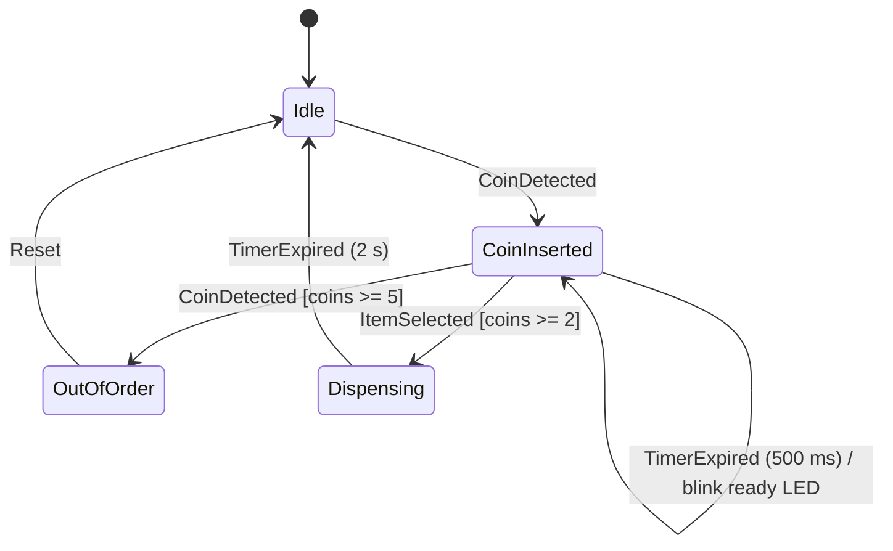

# ESP32 FSM Vending Machine

A simplified vending machine as a second, more complex FSM example: insert coins, select an item, get it dispensed – or end up "out of order".

> **Learning path:** 3. FSM · [← Previous: FSM Traffic Light](../esp32-fsm-traffic-light) · [Next: External Interrupt Button →](../esp32-exti-btn)

## New Concepts

- `enum class`: scoped, type-safe enums (`VendingState::Idle`)
- `static_cast<int>()` to print an `enum class` value
- Formatted output with `Serial.printf()`
- **Guards**: a transition only happens if a condition is true (`coinCounter >= requiredCoins`)
- `struct`: grouping the variables that belong to one button
- **Pass by reference** (`Button &button`): one `buttonPressed()` function for three buttons
- A timer that is only running in some states (`stopTimer()`)

## State Diagram



## Wiring

| Part                  | ESP32 pin | Wokwi key | Notes                       |
| --------------------- | --------- | --------- | --------------------------- |
| "Insert Coin" button  | GPIO 34   | `Space`   | 10 kΩ pull-up, active low   |
| "Select Item" button  | GPIO 35   | `s`       | 10 kΩ pull-up, active low   |
| "Reset" button        | GPIO 27   | `r`       | 10 kΩ pull-up, active low   |
| Error LED (red)       | GPIO 19   |           | 220 Ω resistor to GND       |
| Ready LED (green)     | GPIO 18   |           | 220 Ω resistor to GND       |

Serial monitor: 115200 baud. In Wokwi, click on the simulation first to use the keyboard shortcuts.

## Usage

1. Ready LED on → machine is `Idle`.
2. Press *Insert Coin* → ready LED blinks.
3. Press *Select Item* with at least 2 coins → dispensing for 2 s, then back to idle.
4. Insert 5 coins → error LED, machine is `OutOfOrder` until *Reset*.

## How it works

The structure is the same as in [FSM Traffic Light](../esp32-fsm-traffic-light), and it follows the same [rules of thumb](../esp32-fsm-traffic-light#fsm-rules-of-thumb): `loop()` only generates events, `handleEvent()` contains the transitions, `enterState()` the entry actions.

**Guards.** The same event can lead to different states depending on a condition. `ItemSelected` in `CoinInserted` only starts dispensing if enough coins were inserted. Otherwise the machine stays where it is and prints a message. The fifth `CoinDetected` jams the machine (`OutOfOrder`).

**One event, different meanings.** `TimerExpired` blinks the ready LED in `CoinInserted` (internal transition) but ends dispensing in `Dispensing`. `Idle` and `OutOfOrder` don't need a timer, so they call `stopTimer()`.

**Three buttons, one function.** [Button Toggle with millis()](../esp32-btn-toggle-millis) stored the debounce state in global variables, so `buttonPressed()` only worked for one button. Here the variables of each button are grouped in a `struct`:

```cpp
struct Button
{
  uint8_t pin;
  bool lastState;
  bool lastStableState;
  uint32_t lastChangeTime;
};

Button coinButton = {coinButtonPin, HIGH, HIGH, 0};
```

`buttonPressed(Button &button)` takes the button **by reference**. The `&` means the function works on the original struct, not on a copy. Without it, the updated states would be lost after every call. The [Component Drivers](../esp32-component-drivers) example takes the next step and turns this struct into a class.

> **Later:** in section 7 this vending machine gets an OLED display: [Project Vending Machine with Display](../esp32-project-vending-machine).

## Exercises

1. Add a *Cancel* button that returns the coins (back to `Idle`). In which states should it work?
2. Add a timeout: if no item is selected within 10 s, return the coins. The timer is already used for blinking. How can you add a second timer?
3. Support two items with different prices (two select buttons).

## Further Reading

- [`enum class` (cppreference)](https://en.cppreference.com/w/cpp/language/enum#Scoped_enumerations)
- [Structs / classes (cppreference)](https://en.cppreference.com/w/cpp/language/classes)
- [References (cppreference)](https://en.cppreference.com/w/cpp/language/reference)
